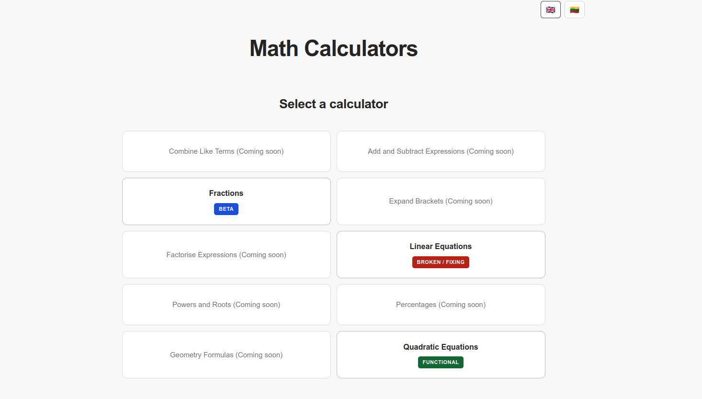

# Math Calculators

**Learn the process, not just the answer.**

Math Calculators is a free, student-focused website that helps students understand mathematics through detailed, step-by-step solutions.

Instead of simply providing an answer, it explains the calculations using clear mathematical notation and notebook-style workings.

Developed by **[Vėjas Kašėta](https://github.com/v4jas2020)** as a Hack Club project.


---

## Preview



*Interactive mathematical input and step-by-step solutions.*

## Features

- **Step-by-step solutions** — Understand every stage of a calculation.
- **Visual maths editor** — Enter mathematical expressions using properly formatted symbols.
- **Exact calculations** — Fractions, square roots and symbolic answers.
- **Notebook-style workings** — Clear and readable mathematical explanations.
- **Two languages** — 🇬🇧 English and 🇱🇹 Lithuanian.
- **Responsive design** — Support for desktop and mobile devices.

## Calculators

| Calculator | Status |
|---|---|
| Quadratic Equations | Functional |
| Fractions | Beta |
| Linear Equations | Functional |
| Expand Brackets | Functional |
| Combine Like Terms | Planned |
| Factorise Expressions | Planned |
| Powers and Roots | Planned |
| Percentages | Planned |
| Geometry Formulas | Planned |

## Technologies

| Frontend | Backend |
|---|---|
| HTML5 | Python |
| CSS3 | FastAPI |
| JavaScript | SymPy |
| MathLive | |
| MathJax | |

**Hosting:** Vercel

## Getting Started

Clone the repository:

```bash
git clone https://github.com/v4jas2020/math-calculator.git
cd math-calculator
```

Install dependencies:

```bash
python -m pip install -r backend/requirements.txt
```

Start the development server:

```bash
python -m uvicorn backend.main:app --reload
```

Visit **http://127.0.0.1:8000**.

## Roadmap

- [x] Quadratic equation solver
- [x] Fractions calculator
- [x] Linear equation solver
- [x] Visual mathematical editor
- [x] English and Lithuanian support
- [x] Finish testing Expand Brackets
- [ ] Improve advanced mathematical explanations
- [ ] Add more calculators
- [ ] Add educational guides
- [ ] Improve mobile support

## Contributing

Suggestions, bug reports and improvements are welcome.

[Open an issue](https://github.com/v4jas2020/math-calculator/issues) to report a problem or suggest a feature.

## Support the Project

If Math Calculators is useful to you, consider [starring the repository](https://github.com/v4jas2020/math-calculator).

---

**Developed and maintained by Vėjas Kašėta.**

*Created as a Hack Club project.*

**For the people interested this is being developed during "hackclub terra" week 2, terra week 3, and I plan to finish it in terra week 5 or 6, in total its a far way to go especialy regarding mobile functions.**